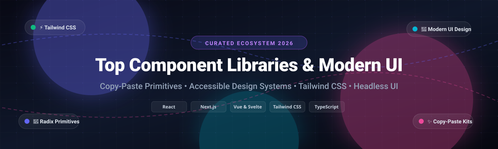

# Awesome Computer Graphics &amp; GLSL Shader Authoring 🎨✨

<p align="center">
  
</p>

<p align="center">
  <a href="https://github.com/ishandutta2007/Awesome-Awesome-Awesome"></a><a href="https://discord.gg/jc4xtF58Ve"></a>
  <a href="https://github.com/ishandutta2007/Awesome-Computer-Graphics-GLSL-Shader-Authoring/stargazers"></a>
  <a href="https://github.com/ishandutta2007/Awesome-Computer-Graphics-GLSL-Shader-Authoring/network/members"></a>
  <a href="https://github.com/ishandutta2007/Awesome-Computer-Graphics-GLSL-Shader-Authoring/issues"></a>
  <a href="https://github.com/ishandutta2007/Awesome-Computer-Graphics-GLSL-Shader-Authoring/blob/main/LICENSE"></a>
  <a href="https://github.com/ishandutta2007"></a>
</p>

---

### 🚀 Top Component Libraries, Headless UI Primitives &amp; Modern UI Design Systems Ecosystem

> **A curated showcase of premier SaaS/hosted platforms and battle-tested open-source GitHub projects for frontend engineers, UI/UX designers, and full-stack software architects.**  
> *Discover high-performance copy-paste component kits, accessible WAI-ARIA headless primitives, Tailwind CSS suites, animated landing page blocks, and enterprise design systems across React, Next.js, Vue, Svelte, Solid, and Angular.*

**📅 Last updated: November 2026**

---

## 📌 Table of Contents

- [📊 Sector Overview &amp; Market Dynamics](#-sector-overview--market-dynamics)
- [💼 SaaS &amp; Hosted Platforms](#-saas--hosted-platforms)
- [🔓 Open-Source GitHub Projects](#-open-source-github-projects)
  - [🏆 High-Star Repositories (Ranked by Stars)](#-high-star-repositories-ranked-by-stars)
  - [💎 Specialized &amp; Ecosystem Component Registries](#-specialized--ecosystem-component-registries)
- [🛠️ Framework Architecture Guide](#-framework-architecture-guide)
- [🤝 How to Contribute](#-how-to-contribute)
- [⭐ Star History](#-star-history)
- [💖 Support &amp; Share](#-support--share)
- [⚖️ Disclaimer](#-disclaimer)

---

## 📊 Sector Overview &amp; Market Dynamics

The front-end UI component libraries and design systems software market is estimated at approximately **$3.8 billion** and projected to reach **$12.4 billion** by the early 2030s (expanding at a compound annual growth rate of ~12.5% CAGR). UI component libraries represent the single largest share of this market (~45%), propelled by enterprise requirements for cross-device consistency, strict accessibility compliance (WCAG 2.2 / WAI-ARIA), and rapid feature development.

The sector exhibits **moderate fragmentation** rather than a winner-take-all monopoly:
- **Enterprise Foundation Giants:** Large-scale organizations and cloud platforms (such as Ant Group, Shopify/Tailwind Labs, and Vercel) maintain comprehensive design foundations, enterprise runtimes, and documentation hubs.
- **Copy-Paste &amp; Headless Paradigm Shift:** Rather than monolithic black-box npm packages, developers overwhelmingly prefer decentralized, unstyled primitives (such as Radix UI, Base UI, and Ark UI) combined with code-ownership CLI registries (such as `shadcn/ui`). This dynamic fosters a thriving, distributed ecosystem where independent creators, boutique component registries, and open-source maintainers operate sustainably alongside enterprise players.

---

## 💼 SaaS &amp; Hosted Platforms

*Below is a comprehensive comparison of leading hosted component platforms, UI block suites, and commercial design registries, sorted in descending order by company valuation / revenue.*

| Platform | 🏢 Company Size (Valuation / Revenue) | 💳 Starting Tier Pricing | 🎁 Free Tier / Trial Limits | 📝 Description |
| :--- | :--- | :--- | :--- | :--- |
| **[Ant Design Pro](https://ant.design)** | **~$78B–$103B Valuation** (~$37B annual revenue, Ant Group) | **$0 / Free** (Enterprise consulting / custom cloud scaffolds via Ant Digital) | **Free forever without restrictions** (100% open-source Apache-2.0 enterprise scaffold &amp; dashboard blueprints; no license walls) | Enterprise-grade admin console design ecosystem offering commercial scaffolded layouts, business components, and internationalized dashboard blueprints. |
| **[Tailwind Plus (formerly Tailwind UI)](https://tailwindcss.com)** | **~$110B+ Market Cap** (Parent: Shopify, acquired Tailwind Labs in Sep 2026; previously ~$4M+ ARR bootstrapped) | **$299** (One-time payment for lifetime personal license; team license at $979) | **Free forever limited preview** (Access to ~12 free preview components; public new checkouts paused post-Shopify acquisition) | Official commercial UI kit from the creators of Tailwind CSS offering hundreds of professionally designed application UI, marketing, and e-commerce templates in HTML, React, and Vue. |
| **[Tremor Blocks / Pro](https://tremor.so)** | **$9.3B Valuation** ($200M+ ARR, acquired by Vercel in Jan 2025) | **$0 / Free** (Integrated into Vercel open-source tools; $20/mo Vercel Pro for hosting) | **Free forever without restrictions** (Full library of dashboard blocks, charts, and templates released as 100% free open-source MIT) | Commercial collection of polished analytics, KPI card, and financial dashboard UI blocks built on Tailwind CSS and open-source Tremor primitives. |
| **[MUI Store &amp; MUI X Pro/Premium](https://mui.com)** | **~$10M–$15M Est. Valuation** (~$4M–$5M ARR, profitable &amp; bootstrapped) | **$299 / developer / year** (Annual subscription for MUI X Pro license) | **Free forever Community tier** (MIT license: standard single-column filter, basic pagination; excludes DateRangePicker, column pinning, Excel export, and row grouping) | Official Material UI marketplace and enterprise component tier featuring advanced data grids, date/time range pickers, charts, and commercial React/Next.js dashboard templates. |
| **[Relume](https://relume.io)** | **~$15M–$20M Est. Valuation** (~$3.3M ARR, 30 employees, bootstrapped) | **$38 / month** (Billed annually for Starter plan, or $48/mo billed monthly) | **Free forever plan** (1 project, 1 page/project, 1,500 monthly page views, 1 AI generation/mo, 30 Webflow/React components, Figma exports only) | AI-powered site builder and massive component library (1,000+ Webflow, Figma, and React/Tailwind components) engineered for rapid wireframing and marketing site production. |
| **[Flowbite Pro](https://flowbite.com)** | **~$8M–$12M Est. Valuation** (~$2.6M+ cumulative revenue, Bergside Inc., bootstrapped) | **$169** (One-time purchase for Designer Edition; $299 one-time for Developer Edition) | **Free forever Community tier** (MIT license: 600+ core Tailwind components; excludes advanced app templates, complex data tables, and Figma design system) | Commercial design system and UI kit extending open-source Flowbite with Figma variables, dashboard templates, e-commerce blocks, and application UI sections. |
| **[Chakra UI Pro](https://chakra-ui.com)** | **~$3M–$5M Est. Valuation** (~$500K–$1M ARR, Chakra Systems / Segun Adebayo, bootstrapped) | **$299** (One-time payment for lifetime Personal license; $899 lifetime for Team license) | **Free forever core library** (Open-source Chakra UI MIT baseline components; Pro sections provide sample preview code only) | Commercial suite of responsive, accessible, multi-theme marketing and application UI blocks built directly on top of open-source Chakra UI. |
| **[HeroUI Pro (formerly NextUI Pro)](https://heroui.pro)** | **~$2M–$4M Est. Valuation** (~$300K–$600K ARR, HeroUI Inc., bootstrapped) | **$299** (One-time payment for lifetime individual Web Hero license; formerly $249) | **Free forever open-source core** (Full HeroUI Apache-2.0 core components free; Pro blocks have 0 free tiers, only visual public demos) | Commercial library of 200+ responsive, accessible Tailwind CSS and Framer Motion UI blocks built on the open-source HeroUI component system. |
| **[Shadcn UI Pro / Commercial Registries (e.g., Shadcnblocks / Origin UI Pro)](https://shadcn.com)** | **~$1M–$3M Est. Valuation** (~$200K–$500K ARR across indie block registries, bootstrapped) | **$79** (One-time payment starting tier for Shadcnblocks lifetime license) | **Free forever plan** (17 MIT open blocks + 22 basic blocks upon registration on Shadcnblocks; 2 copies/day on 21st.dev free tier) | Ecosystem of commercial block marketplaces and SaaS starter kits built around the open-source `shadcn/ui` CLI registry specification. |

---

## 🔓 Open-Source GitHub Projects

*The open-source design system ecosystem empowers developers to build accessible, themeable web interfaces without licensing lock-in. Below, repositories are equipped with live stargazers badges (`style=social`, `color=white`) linking directly to each repository's stargazers page, sorted in **descending order by Stars_Count**.*

### 🏆 High-Star Repositories (Ranked by Stars)

1. **[shadcn/ui (`shadcn-ui/ui`)](https://github.com/shadcn-ui/ui)** [](https://github.com/shadcn-ui/ui/stargazers)  
   🔥 *Flagship open-source collection of re-usable, accessible, copy-paste React components built with Tailwind CSS and Radix/Base UI primitives. Instead of an npm dependency, you own the component source directly in your repository.*

2. **[Ant Design (`ant-design/ant-design`)](https://github.com/ant-design/ant-design)** [](https://github.com/ant-design/ant-design/stargazers)  
   🏢 *Enterprise-class React UI design language and comprehensive component suite created by Ant Group. Features hundreds of battle-tested inputs, complex virtualized data tables, cascading menus, and full internationalization.*

3. **[Material UI (`mui/material-ui`)](https://github.com/mui/material-ui)** [](https://github.com/mui/material-ui/stargazers)  
   🎨 *The world's most popular React implementation of Google's Material Design specification. Features a robust theme engine, zero-runtime Emotion/Pigment CSS styling options, and an extensive ecosystem of enterprise add-ons.*

4. **[daisyUI (`saadeghi/daisyui`)](https://github.com/saadeghi/daisyui)** [](https://github.com/saadeghi/daisyui/stargazers)  
   🌼 *The most widely deployed component plugin for Tailwind CSS. Adds clean, semantic utility classes (like `btn`, `card`, `modal`) that drastically reduce HTML verbosity while supporting 30+ pre-built themes with zero runtime overhead.*

5. **[Chakra UI (`chakra-ui/chakra-ui`)](https://github.com/chakra-ui/chakra-ui)** [](https://github.com/chakra-ui/chakra-ui/stargazers)  
   ⚡ *Simple, modular, and accessible React component library offering intuitive style props, semantic tokens, and Ark UI state-machine integration for seamless design system creation.*

6. **[Mantine (`mantinedev/mantine`)](https://github.com/mantinedev/mantine)** [](https://github.com/mantinedev/mantine/stargazers)  
   🛡️ *A comprehensive, batteries-included React component and hooks library featuring 100+ customizable components, forms management, rich-text editors, nested notification systems, and native dark-mode styling.*

7. **[HeroUI (`heroui-inc/heroui`, formerly NextUI)](https://github.com/heroui-inc/heroui)** [](https://github.com/heroui-inc/heroui/stargazers)  
   ✨ *Modern, visually stunning React UI library built on Tailwind CSS and React Aria. Delivers butter-smooth spring animations, automatic dark-mode contrast, and zero-runtime CSS overhead.*

8. **[Headless UI (`tailwindlabs/headlessui`)](https://github.com/tailwindlabs/headlessui)** [](https://github.com/tailwindlabs/headlessui/stargazers)  
   🧠 *Completely unstyled, fully accessible UI components engineered by Tailwind Labs. Designed to integrate natively with Tailwind CSS utility classes across React and Vue applications.*

9. **[Lucide Icons (`lucide-icons/lucide`)](https://github.com/lucide-icons/lucide)** [](https://github.com/lucide-icons/lucide/stargazers)  
   💎 *Beautiful and consistent open-source icon toolkit (fork of Feather Icons) with 1,400+ vector glyphs and official packages for React, Vue, Svelte, Angular, and Tailwind CSS design systems.*

10. **[Magic UI (`magicuidesign/magicui`)](https://github.com/magicuidesign/magicui)** [](https://github.com/magicuidesign/magicui/stargazers)  
    🪄 *Open-source collection of 50+ animated landing page UI components, interactive border beams, radiant text gradients, and particle effects built with Tailwind CSS and Framer Motion.*

11. **[Tabler Icons (`tabler/tabler-icons`)](https://github.com/tabler/tabler-icons)** [](https://github.com/tabler/tabler-icons/stargazers)  
    📐 *Set of over 5,200 free, open-source high-quality SVG icons designed on a 24x24 grid with 2px stroke, standard across web dashboards and mobile applications.*

12. **[Radix UI Primitives (`radix-ui/primitives`)](https://github.com/radix-ui/primitives)** [](https://github.com/radix-ui/primitives/stargazers)  
    🧩 *Unstyled, accessible, WAI-ARIA-compliant open-source React UI primitives (dialogs, dropdowns, popovers, tabs, tooltips, accordions) powering `shadcn/ui` and modern web design systems.*

13. **[Taxonomy (`shadcn-ui/taxonomy`)](https://github.com/shadcn-ui/taxonomy)** [](https://github.com/shadcn-ui/taxonomy/stargazers)  
    🏗️ *An open-source, full-stack application built using Next.js 13+ App Router, Server Components, shadcn/ui primitives, Prisma, and Tailwind CSS showcasing best practices in web application architecture.*

14. **[React Spectrum &amp; React Aria (`adobe/react-spectrum`)](https://github.com/adobe/react-spectrum)** [](https://github.com/adobe/react-spectrum/stargazers)  
    🎯 *Adobe's open-source accessibility-first library of UI hooks and components providing battle-tested keyboard navigation, screen-reader compliance, touch interactions, and multi-language internationalization.*

15. **[Base UI (`mui/base-ui`)](https://github.com/mui/base-ui)** [](https://github.com/mui/base-ui/stargazers)  
    🧱 *Next-generation unstyled, accessible UI component library maintained by the creators of Radix, Floating UI, and Material UI, featuring modern CSS anchor positioning and ergonomic subcomponents.*

16. **[shadcn-vue (`unovue/shadcn-vue`)](https://github.com/unovue/shadcn-vue)** [](https://github.com/unovue/shadcn-vue/stargazers)  
    💚 *The official Vue / Nuxt community port of `shadcn/ui`, powered by Radix Vue and Tailwind CSS for developer-owned, copy-pasteable Vue component architectures.*

17. **[Flowbite (`themesberg/flowbite`)](https://github.com/themesberg/flowbite)** [](https://github.com/themesberg/flowbite/stargazers)  
    🌊 *Comprehensive open-source library of 600+ UI components, sections, and pages built with Tailwind CSS utility classes and vanilla JavaScript/React/Vue/Svelte wrappers.*

18. **[shadcn-svelte (`huntabyte/shadcn-svelte`)](https://github.com/huntabyte/shadcn-svelte)** [](https://github.com/huntabyte/shadcn-svelte/stargazers)  
    🧡 *The official Svelte / SvelteKit community port of `shadcn/ui`, built on top of Bits UI and Tailwind CSS for reactive, zero-bloat web interfaces.*

19. **[Ariakit (`ariakit/ariakit`)](https://github.com/ariakit/ariakit)** [](https://github.com/ariakit/ariakit/stargazers)  
    ♿ *Toolkit for building accessible web applications, flexible design systems, and rich React composite widgets following WAI-ARIA authoring practices.*

20. **[Motion Primitives (`ibelick/motion-primitives`)](https://github.com/ibelick/motion-primitives)** [](https://github.com/ibelick/motion-primitives/stargazers)  
    🎬 *Smooth, copy-paste UI motion components and micro-interactions created with Tailwind CSS and Framer Motion for modern SaaS landing pages and product dashboards.*

21. **[Ark UI (`chakra-ui/ark`)](https://github.com/chakra-ui/ark)** [](https://github.com/chakra-ui/ark/stargazers)  
    🤖 *Universal headless library powered by finite state machines (Zag.js), delivering identical accessible component behaviors across React, Vue, and Solid.*

22. **[Tremor (`tremorlabs/tremor`)](https://github.com/tremorlabs/tremor)** [](https://github.com/tremorlabs/tremor/stargazers)  
    📈 *Open-source React dashboard component library built with Tailwind CSS and Recharts. Offers ready-to-use KPI cards, area charts, bar graphs, and sparklines.*

23. **[Park UI (`cschroeter/park-ui`)](https://github.com/cschroeter/park-ui)** [](https://github.com/cschroeter/park-ui/stargazers)  
    🌲 *Multi-framework copy-paste UI component system engineered on Ark UI state machines and styled with Panda CSS or Tailwind CSS.*

24. **[Islandcn (`opencoredev/islandcn`)](https://github.com/opencoredev/islandcn)** [](https://github.com/opencoredev/islandcn/stargazers)  
    🏝️ *Modular, lightweight UI component library and registry inspired by `shadcn/ui`, optimized for clean interface primitives and modern copy-paste workflows.*

---

### 💎 Specialized &amp; Ecosystem Component Registries

- **[Aceternity UI](https://ui.aceternity.com/)** — Copy-paste animated cards, glowing gradients, and 3D parallax effects for landing pages built with Tailwind CSS and Framer Motion.
- **[21st.dev](https://21st.dev/)** — The open npm-for-design registry where creators publish and install community-crafted Tailwind and shadcn-compatible UI blocks via CLI.
- **[Origin UI](https://originui.com/)** — Extensive catalog of beautiful, accessible inputs, sliders, switches, and buttons built on Tailwind CSS and Radix Primitives.
- **[Cult UI](https://www.cult-ui.com/)** — Curated set of creative, physics-based, interactive micro-components for next-gen interactive web applications.
- **[HyperUI](https://www.hyperui.dev/)** — Free open-source Tailwind CSS components for marketing websites, dashboard layouts, and e-commerce stores.

---

## 🛠️ Framework Architecture Guide

When designing and deploying modern user interfaces, choose the right architectural layer based on your team's technical constraints:

```text
┌────────────────────────────────────────────────────────────────────────┐
│                      APPLICATION DESIGN LAYER                          │
│          (Tailwind Plus, Relume, Shadcnblocks, Flowbite Pro)           │
├────────────────────────────────────────────────────────────────────────┤
│                      COPY-PASTE REGISTRY LAYER                         │
│            (shadcn/ui, Magic UI, shadcn-vue, shadcn-svelte)            │
├────────────────────────────────────────────────────────────────────────┤
│                   BATTERIES-INCLUDED SUITE LAYER                       │
│              (Ant Design, Material UI, Mantine, HeroUI)                │
├────────────────────────────────────────────────────────────────────────┤
│                   HEADLESS ACCESSIBILITY PRIMITIVES                    │
│           (Radix UI, Base UI, React Aria, Headless UI, Ark UI)         │
├────────────────────────────────────────────────────────────────────────┤
│                       STYLING & TOKEN ENGINE                           │
│              (Tailwind CSS, CSS Modules, Panda CSS, Style Props)       │
└────────────────────────────────────────────────────────────────────────┘
```

- **For rapid internal dashboard applications:** Choose **Ant Design** or **Mantine** for rich built-in data tables, filters, and stateful form controls.
- **For enterprise client-facing web apps:** Pair **shadcn/ui** or **Base UI** with **Tailwind CSS** to retain 100% source code ownership and avoid library lock-in.
- **For marketing sites &amp; high-impact landing pages:** Combine **Magic UI** or **Motion Primitives** with **HeroUI** or **daisyUI** for physics-based spring animations.
- **For cross-framework teams (Vue, Svelte, Solid, React):** Use **Ark UI** or **Headless UI** to standardize accessibility behavior across different framework stacks.

---

## 🤝 How to Contribute

Contributions are warmly welcomed! Help make this curated index the web's definitive guide to modern UI components:

1. 🍴 **Fork the repository** to your GitHub profile.
2. 🌿 **Create a new branch** (`git checkout -b feature/add-new-ui-library`).
3. 📝 **Add your entry** under the appropriate section in `README.md` (keep alphabetical or star-ranked consistency).
4. 🔗 **Ensure accurate links**, official live documentation, and concise, objective descriptions.
5. 🚀 **Submit a Pull Request** with a brief summary of the project.

---

## ⭐ Star History

[](https://www.star-history.com/#ishandutta2007/Awesome-Computer-Graphics-GLSL-Shader-Authoring&type=date&legend=top-left)

---

## 💖 Support &amp; Share

Thank you so much for exploring this curated repository! If you found this resource helpful for your front-end development, design system architecture, or next web project, please consider supporting the project:

- ⭐ **Star this repository** on GitHub to amplify its reach and help other developers discover it.
- 🍴 **Fork and share** the repo with your engineering teammates, design squads, and communities on X/Twitter, LinkedIn, and Reddit.
- ☕ **Buy me a coffee &amp; sponsor my open-source work**: Support continuous maintenance, new evaluations, and community tooling via the [Sponsor Dashboard](https://github.com/sponsors/ishandutta2007) — featuring tiers for profile badges, repository shoutouts, and prioritized feature requests!

[](https://github.com/sponsors/ishandutta2007)

---

## ⚖️ Disclaimer

- This repository is a **community-curated index** published for informational, educational, and developer reference purposes. Mention of commercial products does not constitute an endorsement.
- Always perform accessibility audits (using Axe, Lighthouse, and NVDA/VoiceOver screen readers) to verify WCAG 2.2 AA compliance before shipping copy-paste components to production.
- Always review individual open-source (MIT, Apache-2.0) and commercial licensing terms before bundling UI kits into client deliverables or proprietary products.

---

<p align="center">
  <b>Built with ❤️ for frontend engineers, UI/UX designers, and open-source creators worldwide.</b><br/>
  <sub>Accelerating the next generation of beautiful, accessible web interfaces.</sub>
</p>
